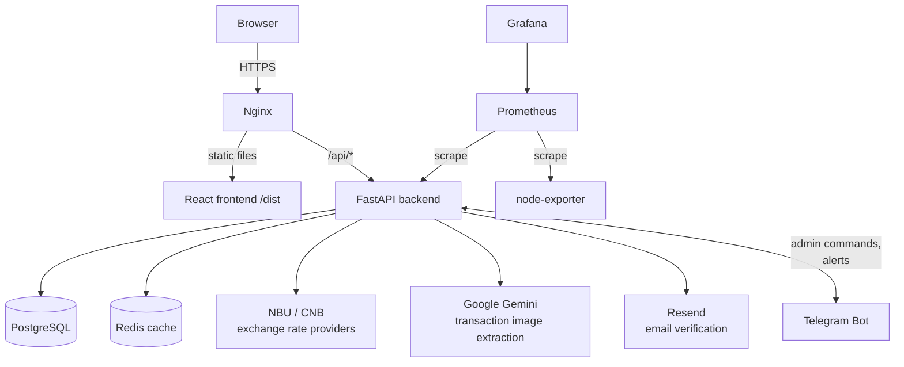
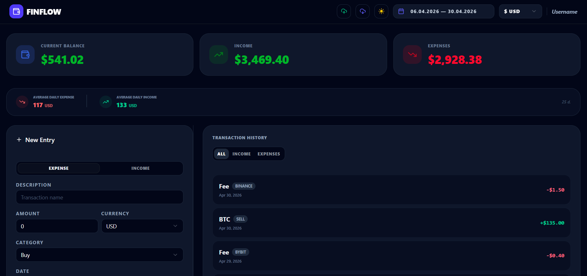
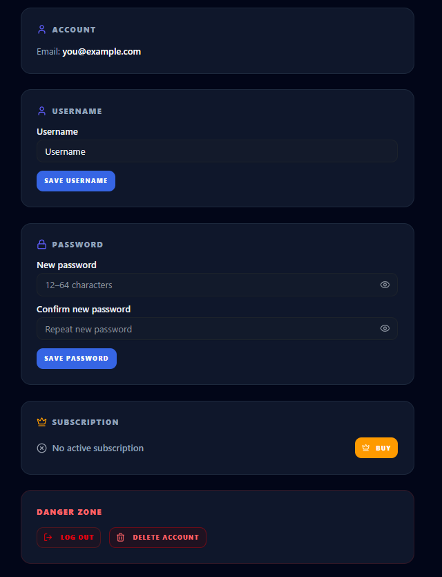
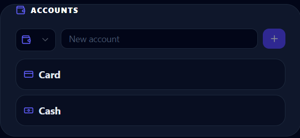
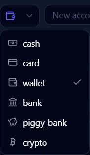
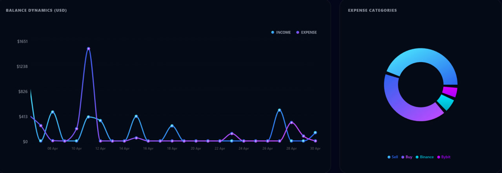
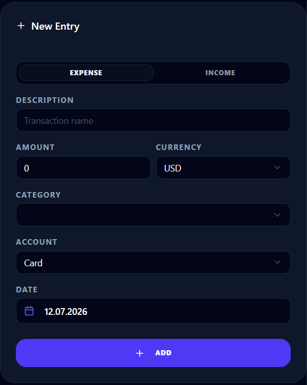
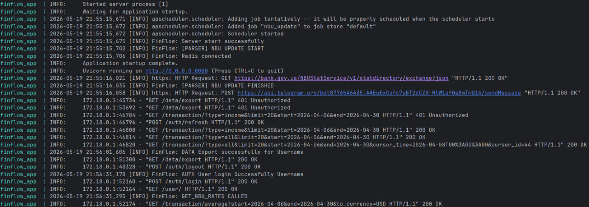
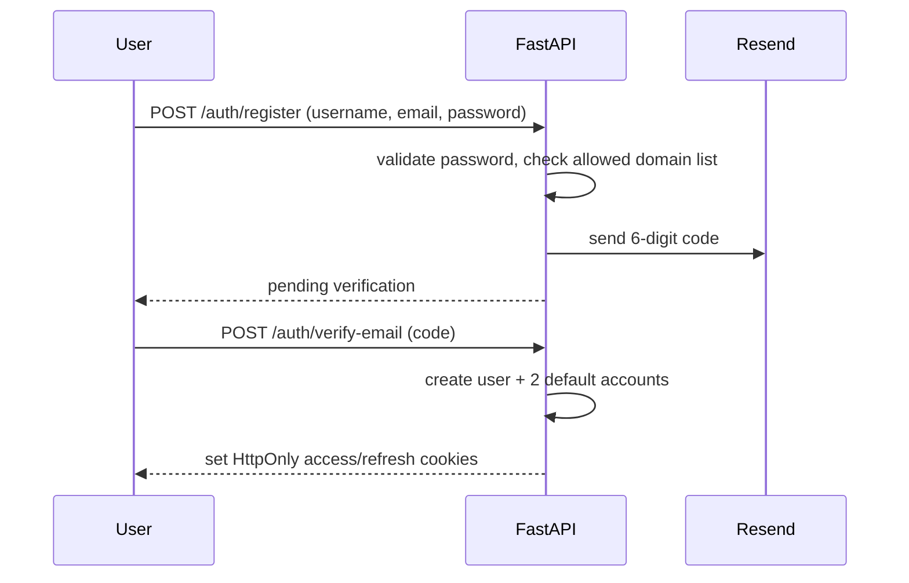

# FinFlow — Personal Finance Manager

Full-stack personal finance tracker: incomes/expenses, flexible accounts and categories, real-time multi-currency conversion with a tiered fallback strategy.

---

## Live

**[https://finflow.website](https://finflow.website)**

In production since staging completed in 2026. Health and activity are monitored continuously through a Telegram bot integration: the backend pushes event-driven alerts on errors, auth activity, and currency-source switches — not a periodic ping, but a message the moment something happens. An authorized admin can also switch the active exchange-rate source at runtime via Telegram commands, without a redeploy.

---

## Recognition

**1st place, Web Development category** — IT Student Projects Competition, Kyiv, May 2026 (Ministry of Education and Science of Ukraine, Decree No. 23/2026).

---

## Architecture



Backend, database, and cache run as isolated services in Docker Compose, with no database ports exposed to the host network. Nginx terminates TLS and reverse-proxies to the backend, stripping the `/api/` prefix and injecting `X-Real-IP` / `X-Forwarded-For`.

---

## Deployment & Infrastructure

- **Web server / reverse proxy**: Nginx serves the compiled React frontend (built with `pnpm`) and reverse-proxies API traffic to FastAPI.
- **Containerization**: Backend, PostgreSQL, and Redis run in Docker Compose on an internal bridge network — no database ports exposed to the host.
- **TLS**: Certificates via Let's Encrypt (Certbot), with enforced HTTP→HTTPS redirection.
- **Server hardening**: SSH key-only access (password auth disabled), automated brute-force protection at the host level, active log parsing.
- **Monitoring**: Prometheus scrapes metrics from the FastAPI backend and from the host via node-exporter; Grafana dashboards visualize API performance, request throughput, and host resource usage (CPU, memory, disk, network).
- **Currency rate resilience**: tiered fallback — live Redis cache → active provider (NBU/CNB) → last-known-good persistent cache → static defaults — so the conversion pipeline degrades gracefully instead of failing outright.

*Note: all architecture, backend, frontend, and DevOps work was done solely by me. See [Author](#author--contact) below.*

---

## Key Features

- **Authentication**: JWT-based system with access & refresh token rotation, Argon2 password hashing, rate limiting via SlowAPI.
- **Two-step email verification**: registration requires a 6-digit code (valid 10 minutes), delivered via the Resend API. Registration is protected by a domain allowlist (~60 verified email providers) to filter out temp/disposable emails.
- **Multi-currency**: automatic exchange rate sync with Redis caching. Primary source is the National Bank of Ukraine (NBU); on failure, falls back to the Czech National Bank (CNB) via cross-rate calculation, with a persistent last-known-good cache as final safety net. Active source switchable on demand via Telegram. View balances in USD, EUR, UAH, PLN, CZK, or RUB. RUB uses a manually maintained fixed backend rate, rather than a live bank feed.
- **Accounts**: multi-account system (wallet, card, cash, savings).
  - Two default accounts created automatically on registration.
  - Free tier: limited to 2 accounts. Deleting an account cascades to its associated transactions. At least one active account is always enforced.
  - Account names and icons can be edited after creation.
- **Analytics**: balance/income/expense dashboards, average daily spending/income for a given period, real-time conversion based on live rates. The all-time view uses the earliest and latest transaction dates and refreshes its range after transaction changes.
- **Transactions**: cursor-based pagination for infinite scrolling, filtering by date range/category/type, smart date parsing (English/Russian input).
- **Offline resilience**: previously loaded data is cached in IndexedDB, and new transactions are queued locally during network failures or server unavailability (HTTP 502/503/504). Automatic synchronization resumes on reconnect or server recovery, with manual sync, retry, and discard controls.
- **Idempotent transaction creation**: an optional UUID `client_id` prevents duplicate transactions when requests are retried, with uniqueness enforced per user in PostgreSQL.
- **Data portability**: streaming JSON/CSV export and file import, with a format picker on desktop and mobile. Both formats preserve `client_id` for idempotent re-import; CSV supports automatic delimiter detection and reports invalid rows.
- **Transaction image scanning**: upload receipts, bank statements, transaction histories, or payment screenshots for Gemini extraction. Review, edit, and select draft transactions before explicitly confirming import; scanning itself never saves transactions.
- **Gemini key management**: free users can add, replace, or delete a personal API key in their profile or configure one inline when scanning requires it. Subscribers use the server-provided key. Personal keys are encrypted at rest and never returned by the API.
- **UI**: responsive dashboard with native dark mode.
- **Telegram admin control**: real-time notifications for auth activity, errors, and currency updates, plus a command interface for runtime admin actions.

---

## UI & Application Flow

### Main Dashboard
Balance, income, and expenses converted into the user's preferred currency using live NBU rates.


### Profile


### Accounts
Every user starts with 2 default accounts; users can edit account names and icons, or delete an account (a single active account is always required).


Available account icons when creating or editing an account:



### Analytics & Visualizations


### Transaction Management


### Scan Transactions
Choose **Scan transactions** under **New Entry**. The compact upload area supports desktop drag-and-drop and file selection; at mobile widths it also offers a separate rear-camera input. Accepted images are JPEG, PNG, and WebP, up to 10 MiB in the current configuration. A selected image is previewed with its filename; upload starts only after choosing **Start scanning**.

The review step supports independent editing of names, descriptions, amounts, dates, transaction types, categories, accounts, and currencies. Uncheck rows to exclude them without deleting them from the draft. New-category indicators and the category-creation summary follow the current edits and selection. Selected totals use decimal-safe arithmetic, grouped by currency and income/spending. Leaving the account unset uses the default account.

Only **Confirm and import** persists the selected transactions through JSON import. Errors preserve edits and selection; partial or unknown import outcomes require manual inspection of saved transactions before retrying. Scanned items may have null `client_id`, so scanning or importing the same image again can create duplicates. Scan cancellation retains the image for manual retry; closing the dialog discards its in-memory draft.

**Privacy:** the image is sent to Google for processing. On the free Gemini tier, Google may use submitted data to improve its models. Uploaded images and entered API keys are not persisted by the frontend; preview object URLs are revoked when replaced or unmounted.

### Offline Data & Synchronization
Previously loaded query data is persisted in IndexedDB through TanStack Query, with a maximum restore age of 24 hours. A connection banner indicates when saved data is being shown and offers a retry button to refetch active queries.

When transaction creation fails because of a network error or HTTP 502/503/504, the frontend saves the transaction in a separate IndexedDB outbox, retaining its UUID `client_id` and original timestamp. The queue is scoped to the signed-in user and survives page reloads. Synchronization runs when a user session becomes available, the browser comes back online, or the API reports server recovery; it can also be started manually.

Queued transactions appear with pending, syncing, or failed status and an unsynced counter. Rejected entries display the server error and can be retried or discarded. The current balance excludes unsynced transactions; dashboard queries refresh after successful synchronization. Signing out clears both the persisted query cache and the outbox, including unsynced entries.

### Backend Logging
Time-zone-aware logging covering JWT rotation, payload validation, async Redis caching, and Telegram bot notifications.


*Note: all tokens, usernames, endpoints, and credentials shown above are mock data for demonstration only.*

---

## Tech Stack

**Backend**


**Frontend**


**Monitoring**


---

## Authentication Flow



1. **Sign up**: user submits username, email, password. Backend validates input (password 12–64 chars, email domain against allowlist) and sends a 6-digit code via Resend.
2. **Email verification**: user enters the code. On success, the account is created (with 2 default accounts) and the user is signed in via HttpOnly cookie-based tokens.

Password reset follows the same pattern: a time-limited reset link (valid 10 minutes) sent to the user's email, processed on a dedicated `/reset-password` page.

---

## Transaction Idempotency

`POST /transaction/` accepts an optional UUID `client_id`, also included in transaction responses. Repeating a request with the same `client_id` for the same user returns the existing transaction with its original ID (HTTP 201), rather than creating another record. A reused key returns the original transaction even if the new request contains different transaction details; use a new UUID for each new transaction.

PostgreSQL enforces uniqueness on `(user_id, client_id)` through the `uq_transaction_user_client` constraint. The service also handles insertion conflicts from concurrent retries by fetching the existing transaction. Different users can use the same `client_id` independently. Requests with an omitted or null `client_id` create a new transaction each time.

Alembic revisions `0b41de3fd1c7` and `8a25ee0be2f0` add the nullable UUID column and the unique constraint, respectively; both are required for database-backed deduplication.

---

## Data Import & Export

The dashboard's Import and Export actions open a choice of **JSON** or **CSV**, including on mobile. The existing endpoints support both formats through the `format` query parameter; JSON remains the default for existing clients.

Paths below are backend routes. Through the production reverse proxy, prepend `/api` (for example, `/api/data/export?format=csv`).

| Method | Path | Behavior |
| --- | --- | --- |
| `GET` | `/data/export?format=json` | Stream the user's transactions as a JSON array. |
| `GET` | `/data/export?format=csv` | Stream UTF-8 CSV with a BOM and a header row; the default delimiter is `;`. |
| `POST` | `/data/import?format=json` | Upload a JSON array as the multipart `file` field. |
| `POST` | `/data/import?format=csv` | Upload a UTF-8 CSV file as the multipart `file` field; a BOM is optional. |

CSV export also accepts `delimiter=;` or `delimiter=,`. Both exports include `id`, `client_id`, `name`, `description`, `price`, `category_name`, `account_name`, `created_at`, `currency`, and `transaction_type`, ordered by transaction timestamp and ID. JSON serializes prices as decimal strings, timestamps as ISO 8601 strings, and UUIDs as strings. CSV escapes cells that could be interpreted as spreadsheet formulas.

### JSON and idempotent re-import

```json
[
  {
    "client_id": "3fa85f64-5717-4562-b3fc-2c963f66afa6",
    "name": "Coffee",
    "description": null,
    "price": "150.50",
    "category_name": "Food",
    "account_name": "Cash",
    "created_at": "2026-01-15T10:00:00",
    "currency": "UAH",
    "transaction_type": "spending"
  }
]
```

Imports preserve `client_id`. Batch inserts skip conflicts on `(user_id, client_id)`, so importing the same keyed transactions again saves no additional copies. Existing transactions are retained without updating their details. This behavior applies to both JSON and CSV and is scoped to each user.

Deduplication requires a non-null `client_id`: legacy records or files without one create new transactions on each import. The exported database `id` is ignored during import and does not provide deduplication. Keep the original `client_id` when restoring or transferring an export; use a new UUID for a genuinely new transaction.

Categories and accounts are matched by name and created when missing. An omitted `account_name` uses the user's default account; an omitted `created_at` uses the import time. JSON is validated as a complete array before insertion; malformed JSON or invalid transaction data rejects the import.

Existing category/account names are resolved case-insensitively. Creating missing categories or accounts during import respects the user's subscription limits; a limit failure rejects the import instead of bypassing those limits.

### CSV input and import results

CSV requires the headers `name`, `price`, `currency`, `category_name`, and `transaction_type`. Optional fields are `client_id`, `description`, `account_name`, and `created_at`; unknown columns, including the exported `id`, are ignored. Header names are trimmed and case-insensitive. Comma, semicolon, and tab delimiters are detected automatically, and decimal-comma prices are accepted.

```csv
client_id;name;price;currency;category_name;account_name;transaction_type
3fa85f64-5717-4562-b3fc-2c963f66afa6;Coffee;150,50;UAH;Food;Cash;spending
```

CSV import can save valid rows while reporting invalid rows with their line numbers and field errors. Duplicate non-null `client_id` values within a CSV file are reported as row errors. Missing required headers, duplicate headers, invalid UTF-8, more than 50,000 data rows, or reaching 100 row errors rejects the import. Uploads also undergo backend file-size validation.

Successful imports return HTTP 201 with `message`, `saved`, `failed`, and `errors`. `saved` counts newly inserted transactions; conflicts with existing client IDs are skipped and do not increase `failed`.

## Transaction Scanning API

These are authenticated backend routes; prepend `/api` through the frontend proxy.

| Method | Path | Behavior |
| --- | --- | --- |
| `POST` | `/scan/` | Upload an image in the multipart `file` field; return an unsaved transaction draft. Limited to 5 requests/minute. |
| `GET` | `/users/me/gemini-key` | Return only `has_gemini_key`; never the stored key. |
| `PUT` | `/users/me/gemini-key` | Save or replace a personal key using `{ "key": "..." }` (20–200 characters after trimming). Return HTTP 204; limited to 5 requests/minute. |
| `DELETE` | `/users/me/gemini-key` | Delete the personal key; return HTTP 204. |

The scan draft contains `has_transactions`, an optional `reason`, `items` containing `TransactionData` and `is_new_category`, proposed `new_categories`, and a `skipped` count. No recognizable transactions produces an empty draft with an explanation. The frontend recalculates proposed new categories from the selected edited items before importing through `/data/import?format=json`.

Gemini model candidates are configured in `services/scan/gemini_client.py`. Requests advance to the next candidate for the specific 404 message indicating a model is no longer available to new users, or for HTTP 500/502/503/504. Invalid keys and rate limits stop immediately; arbitrary 404 responses and timeouts do not trigger model fallback. Each Gemini request has a 30-second timeout; the frontend cancels its scan request after 40 seconds, so a fallback sequence may outlast that client deadline.

Missing personal keys return HTTP 402; invalid Gemini keys return HTTP 400, independently of FinFlow authentication. Rate limiting returns HTTP 429; unavailable models and timeouts are surfaced as service errors. Import is never retried automatically after a network error or partial result.

Personal keys are encrypted with Fernet using backend `ENCRYPTION_KEY`; subscribers use backend `GEMINI_API_KEY`. The `00cefedfdf9d` Alembic revision adds user settings storage. The frontend only holds an entered key in temporary component state and clears it after a successful save.

---

## Testing

```bash
pytest -o addopts= --cov=app --cov=core --cov=dao --cov=services --cov=banks --cov=telegram --cov=database --cov=schemes --cov=limiter --cov=config --cov=logger --cov-report=term-missing
```

The backend suite includes mock providers, unit tests, and integration scenarios. Transaction idempotency tests cover repeated requests, requests without a client ID, isolation between users, and a simulated insertion race.

Focused checks for the scanning and currency code:

```bash
pytest -o addopts= tests/mock/test_gemini_client_mock.py tests/mock/test_scan_mock.py tests/mock/test_scan_endpoints_mock.py tests/mock/test_gemini_settings_mock.py tests/unit/test_scan_process.py tests/mock/test_banks_mock.py
cd frontend
node --test tests/scan.test.mjs
pnpm exec tsc --noEmit
pnpm run build
```

Frontend tests use Node's built-in runner and the existing TypeScript compiler. They cover draft validation, selected-row JSON generation, category recalculation, decimal-safe totals, image validation, and API error messages. Backend mocks exercise Gemini responses, model selection, key handling, scan endpoints, and bank rates. Camera behavior, keyboard/focus interaction, and draft recovery after import failures still need browser testing. No frontend lint script is configured.

The following **98% line coverage** report uses `Stmts` to counts executable statements considered by coverage, rather than all physical lines in the repository.

```text
Name                                  Stmts   Miss  Cover   Missing
-------------------------------------------------------------------
app\endpoints\account.py                 38      0   100%
app\endpoints\auth.py                    71      0   100%
app\endpoints\category.py                47      0   100%
app\endpoints\data.py                    53      0   100%
app\endpoints\scan.py                    21      0   100%
app\endpoints\stats.py                   16      0   100%
app\endpoints\transaction.py             74      0   100%
app\endpoints\user.py                    26      0   100%
app\endpoints\user_settings.py           20      4    80%   29-30, 37-38
app\main.py                              85      0   100%
app\utils.py                             12      0   100%
banks\base.py                            22      0   100%
banks\cnb.py                             46      0   100%
banks\nbu.py                             18      0   100%
banks\registry.py                        97      0   100%
config.py                                54      0   100%
core\dependencies.py                     41      4    90%   18-19, 47, 60
core\exceptions.py                       38      0   100%
core\monitoring.py                        3      0   100%
core\security.py                         49      1    98%   86
dao\accounts.py                          57      0   100%
dao\base.py                              14      0   100%
dao\categories.py                        63      0   100%
dao\refresh.py                           22      0   100%
dao\transactions.py                     208      1    99%   442
dao\user_settings.py                     23      9    61%   10-20, 24, 31-40, 44-50
dao\users.py                             53      0   100%
database\base.py                          7      0   100%
database\engine.py                        4      0   100%
database\models.py                       91      1    99%   23
limiter\limiter.py                        3      0   100%
logger.py                                 5      0   100%
schemes\account.py                       15      0   100%
schemes\category.py                      15      0   100%
schemes\data.py                          37      0   100%
schemes\scan.py                          25      0   100%
schemes\settings.py                      12      0   100%
schemes\stats.py                         20      0   100%
schemes\transaction.py                  118      5    96%   64-65, 74-76
schemes\user.py                          43      0   100%
services\auth.py                         99      0   100%
services\crypto.py                       13      0   100%
services\email_sender.py                 17      0   100%
services\exchange\common.py              13      0   100%
services\exchange\csv_export.py          19      0   100%
services\exchange\csv_import.py          55      3    95%   18, 53, 68
services\exchange\import_service.py      48      1    98%   21
services\exchange\json_export.py         27      3    89%   21-23
services\scan\gemini_client.py           43      0   100%
services\scan\prompt.py                   7      0   100%
services\scan\scan_service.py            50      0   100%
services\user_settings.py                28      5    82%   12-13, 17, 21-22
telegram\bot.py                          28      0   100%
telegram\commands.py                     56      0   100%
-------------------------------------------------------------------
TOTAL                                  2169     37    98%
```

---

## CI/CD

GitHub Actions runs on every push to `main` (or manually via `workflow_dispatch`), in two sequential jobs:

1. **`test`** — spins up a clean `ubuntu-latest` runner: checks out the repo, reconstructs `.env` from a GitHub Secret (`ENV_FILE`), starts an isolated test database via `docker-compose.test.yml`, sets up Python 3.12, installs dependencies, and runs the full `pytest` suite. Deployment is blocked if any test fails.
2. **`deploy`** (`needs: test`) — connects to the production VPS over SSH (`appleboy/ssh-action`) using secrets (`VPS_HOST`, `VPS_USER`, `VPS_SSH_KEY`), pulls changes explicitly from `origin main`, rebuilds and restarts backend containers (`docker compose up -d --build`), and includes frontend dependency installation with `pnpm install --frozen-lockfile` before `pnpm run build`.

---

## Security

- Rate limiting on sensitive endpoints (SlowAPI).
- Mandatory email verification via one-time 6-digit code; disposable email protection via strict domain allowlist.
- Schema-level validation via Pydantic v2.
- Fully async I/O for concurrency.
- HttpOnly, Secure, SameSite cookie attributes for token storage.
- Personal Gemini API keys encrypted at rest with Fernet; API responses expose configuration status only.
- Image scanning requires explicit upload and a separate import confirmation after review.

---

## Project Structure

```text
├── .github/                    # GitHub Actions workflows (CI/CD)
├── app/                        # FastAPI application (main.py, utils.py, endpoints/)
│   ├── endpoints/data.py        # JSON/CSV import and export routes
│   ├── endpoints/scan.py        # Transaction image scanning
│   └── endpoints/user_settings.py # Gemini API key management
├── assets/                     # Documentation images and screenshots
├── banks/                      # Exchange-rate providers (NBU, CNB), shared caching, fallback logic
├── core/                       # Security, JWT, dependencies, exceptions
├── dao/                        # Database access (accounts, categories, transactions, users, refresh tokens)
├── database/                   # SQLAlchemy models and engine setup
├── frontend/                   # React/TypeScript source
├── grafana/                    # Grafana provisioning (dashboards, datasources)
├── limiter/                    # Rate limiting configuration
├── migrations/                 # Alembic migration history
├── prometheus/                 # Prometheus scrape configs and alert rules
├── schemes/                    # Pydantic models for validation
├── services/                   # Authentication, email delivery, file exchange, and image scanning
│   ├── auth.py
│   ├── email_sender.py
│   ├── crypto.py               # Fernet encryption for stored secrets
│   ├── user_settings.py        # Personal/server Gemini key resolution
│   ├── scan/                   # Gemini client, extraction prompt, and draft processing
│   └── exchange/
│       ├── common.py           # Shared columns, limits, and CSV cell sanitization
│       ├── import_service.py   # Resolve categories/accounts and batch-insert transactions
│       ├── json_export.py      # Streaming JSON export
│       ├── csv_export.py       # Streaming CSV export
│       └── csv_import.py       # CSV parsing and row-level validation
├── telegram/                   # Async notifications/logs + long-polling admin command handler
├── tests/                      # Integration and unit test suites
├── docker-compose.yml          # Production orchestration
├── docker-compose.test.yml     # Test environment orchestration
├── Dockerfile
├── alembic.ini
├── config.py
├── logger.py
├── pytest.ini
└── requirements.txt
```

---

## Author & Contact

All architecture, backend, frontend, and DevOps work on this project was executed solely by [me](https://discord.com/users/874571768369664051). Real names are omitted for privacy reasons; feel free to reach out via Discord for official verification.

*Local deployment instructions and environment configuration are withheld for security reasons — contact the repository owner for access or inquiries.*